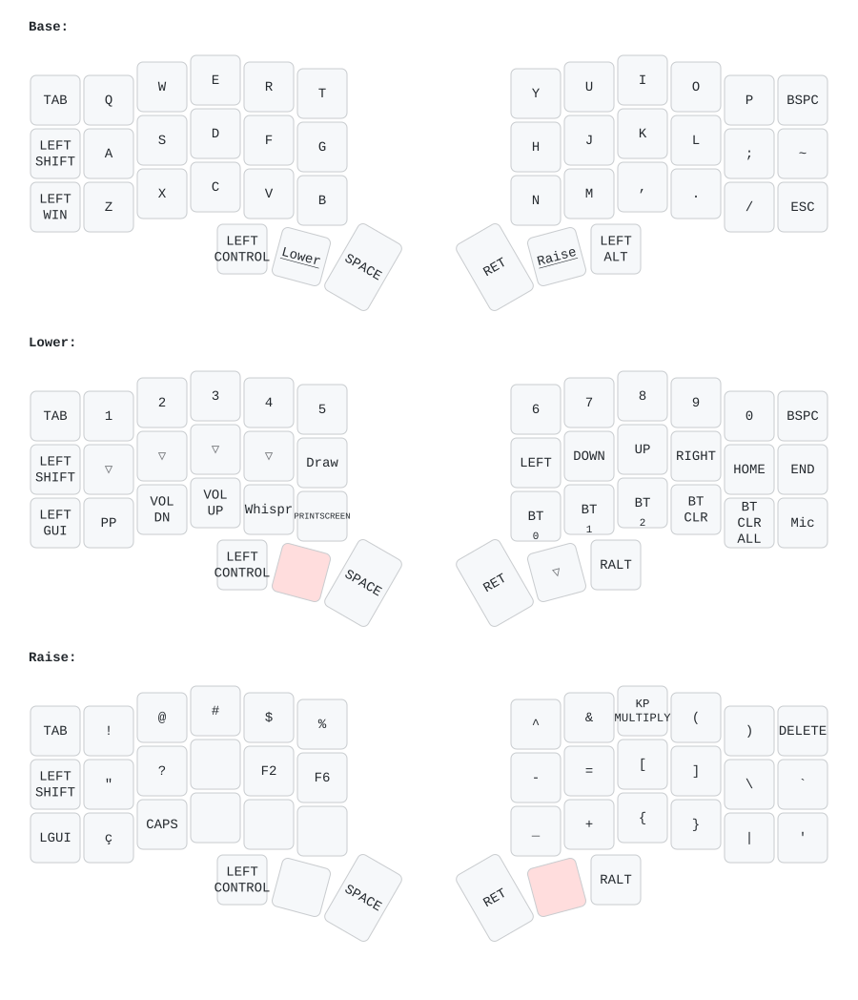

# Corne ZMK config

ZMK firmware config for my Corne (3×6 + 3 thumb keys, nice!nano).

## Layout

The drawing above is generated from [`config/corne.keymap`](config/corne.keymap) by
[keymap-drawer](https://github.com/caksoylar/keymap-drawer) on every push, so it always
matches the keymap. Labels for special keys are set in
[`keymap_drawer.config.yaml`](keymap_drawer.config.yaml).

### Layers

| Layer | How to reach it | What's on it |
|---|---|---|
| **Base** | default | QWERTY |
| **Lower** | hold left middle thumb | Numbers, arrows, Home/End, media, Bluetooth, PC shortcuts |
| **Raise** | hold right middle thumb | Symbols, F2/F6, Caps Lock, Delete |

### PC shortcut keys

These keys send spare function keys, and the app on the PC is set to react to them:

| Key | Sends | Does |
|---|---|---|
| Lower + V | `F8` | Start/stop [OpenWhispr](https://github.com/OpenWhispr/openwhispr) dictation |
| Lower + G | `F23` | Toggle Draw On Gnome (set as its `toggle-drawing` shortcut) |
| Lower + bottom-right | `F24` | Toggle mic in Discord |

## Building and flashing

1. Push to `main` (or run the workflow manually). GitHub Actions builds the firmware.
2. Download the `firmware` artifact from the run.
3. For each half: plug it in, double-tap reset, and copy its `.uf2` onto the `NICENANO` drive.
   Flash the left half first.
